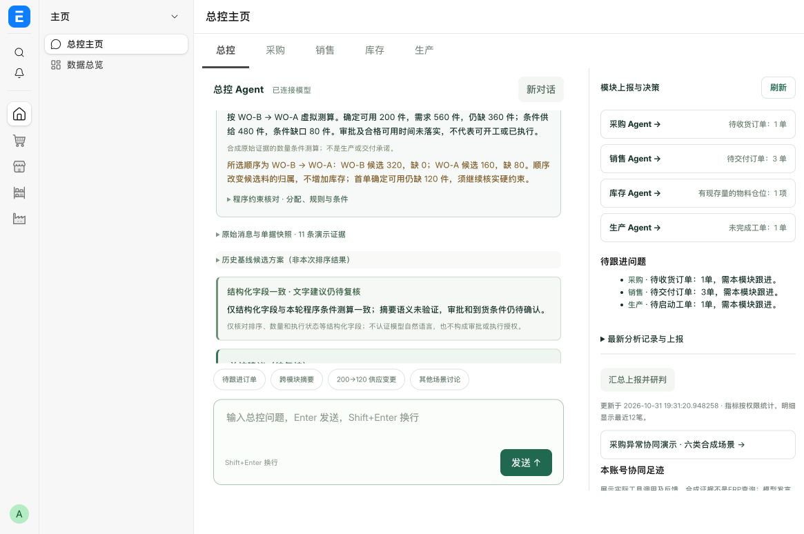

# 订单优先级与约束核验

2026-10-31，本地 `focus.local`。适用范围是 PO-1286 连接器合成案例；没有将本次排序写入真实 ERP 订单，也没有调整库存、采购或审批状态。

## 使用入口

总控主页 →「200→120 供应变更」→「设置本次优先级」→选择先保 A 或 B、填写理由 → 开始核查。已结束的案例可用「调整优先级并复核」创建关联的新轮次，旧证据和旧策略保留。

默认策略为按需料时点排序，明确标识为“非人工指定”。人工策略由服务器记录登录账号、时间、理由与版本；优先级只决定虚拟分配顺序，不能批准挪用预留或放行待检。

## 程序结果

| v2 顺序 | 第一单条件候选量 | 第二单条件候选量 | 条件缺口归属 | 确认可用总缺口 |
| --- | ---: | ---: | --- | ---: |
| A → B | A 240 | B 240 | B 缺 80 | 360 |
| B → A | B 320 | A 160 | A 缺 80 | 360 |

B 优先时，B 的候选量依赖 C 预留调整 120 件；A 的候选量依赖剩余 C 预留调整 40 件及提前批 120 件。A 所依赖的提前批必须在 11 月 3 日 09:00 前到仓、完成本厂收货检验并可领用，不能套用 B 的 13:00 截止。相关条件尚未落实；整批限制下不能把部分数量说成可开工。C 的补回仍须在其原需料时点前落实。

规则面板提供六类规则：企业排序策略、预留调整、品质放行、合格可用时点、销售与工单需求去重、整批与替代料许可。企业策略来自本次业务选择；其他规则同时标注案例边界及 ERPNext 官方参考，未将其宣称为所有电子企业通用法规。

## 一致性与留痕

- 四阶段不变：四部门并行初核 → 总控追问 → 四部门并行复核 → 总控建议；10 条反馈，仍逐步呈现。
- 每一轮预读和单条来源查询都带入同一策略和测算；模型上下文移除旧 A 优先的固定方案，原始历史快照不变。
- 总控末轮返回真实摘要和结构化分配字段；程序比较策略版本、顺序、每单数量、总缺口及未授权执行状态。缺字段、错误值、未能解析都会显示明确状态。
- 字段一致不表示自然语言已被语义验证，不代表到货、质量、审批或开工条件已经满足。程序条件测算和模型建议分开展示，不用固定文案覆盖真实总控发言。
- 策略变更与证据补充分开记录，新轮次保留 `previous_turn`。加入尚未核实的人员补充后，暂停数量分配；仅调整优先级不会重新启用旧数值。

## 自动检查

145 项通过：应用 Python 105、领域与配置 10、前端 30。另通过主页切换、输入法、发送防重等交互检查，以及 56 项部署静态资源检查。

覆盖 A/B 顺序互换、v1/v2 变化、库存互斥与数量守恒、按需料时点重新生成条件、人员补充暂停、来源不可变、账号隔离、更新继承、模型误报与缺字段、额外关联字段核对、内容转义、旧场景兼容。API 测试模拟对话存储与队列，不调用真实模型、不写业务单据。

本地更新使用现有依赖，无结构迁移，保留数据库和站点卷；回退镜像 `caigou-copilot:before-priority`。

## 真实模型与浏览器验收

最终轮次 `bforcc9frg`：34.139 秒、10 次模型请求、10 条反馈、40 条留痕，四阶段全部完成。总控结构化字段核对为 `matched`；真实文字建议正确围绕 B 优先、A 候选缺 80、A 提前批须 09:00 前合格可用展开，没有宣称预留审批或到货已落实。此耗时为单次抽测，不承诺稳定性能。

服务器只读验收通过：新轮次关联上一轮，原始业务证据逐项不变；实际登录账号、策略版本、B/A 顺序、确定缺口 360、条件缺口 80、B/A 候选 320/160 均正确保存。浏览器验证了选择、必填理由、真实调用、逐步反馈及最后核对状态。

