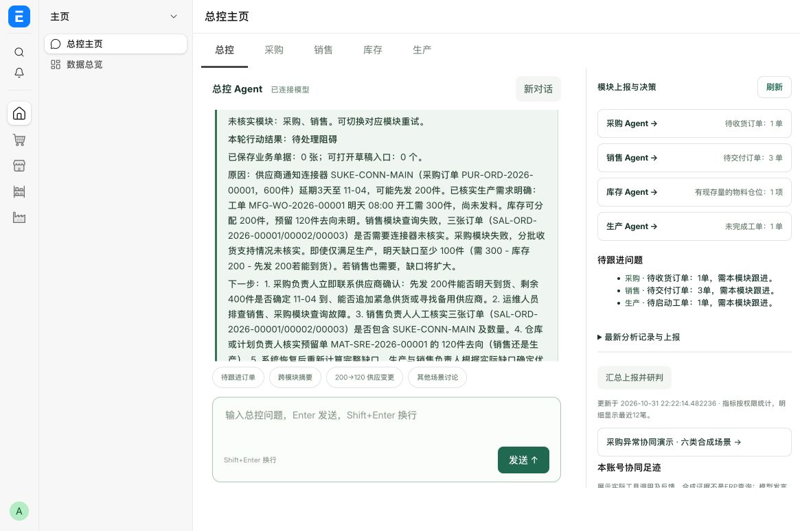
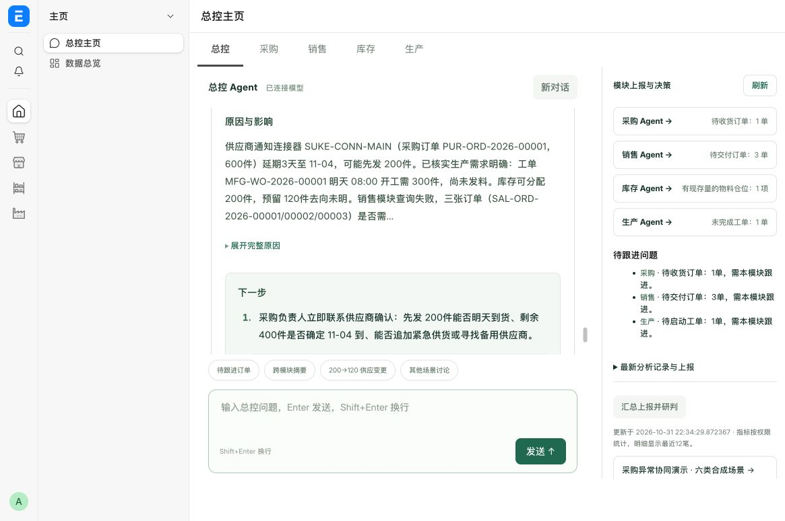

# 行动结果阅读体验验收

日期：2026-10-31。范围：总控聊天结果卡；四阶段协作、模型调用、规则与业务数据均未修改。

## 实际问题与调整

此前完整结论、原因和多项下一步挤在同一浅绿色文本区，行动尾段还与结构化字段重复。现在使用已有 `turn.action` 展示独立行动卡：状态和真实关联单据数量 → 原因与影响 → 编号下一步。主摘要只移除精确的服务端行动尾段，完整模型原文继续保留。

- 长原因默认显示前 200 字，展开显示完整原文；不改写事实或保存内容。
- 明确连续编号（包括中文句号后紧接下一编号）分成列表；日期、小数、缺号和混合格式保持原文。
- 无真实单据/草稿入口时，不凭模型状态声称已建单。
- 加大正文行距和区块间距，行动列表使用独立浅色背景，缩窄右侧信息栏以增加正文宽度。

## 验证结果

- 前端相关测试 37 项通过，交互检查通过，差异格式检查通过。
- 本地静态资源 56 项通过。
- 本地现有聊天记录显示 5 条独立行动；行动卡宽 538px，无水平溢出。
- 点击展开原因后完整文本保留 289 字；键盘回车可收起。
- 当前桌面视口 1165×774 已截图并目视检查。未做全面移动端或辅助技术兼容性认证。
- 没有新增模型调用；没有修改已有回复、留痕或业务单据。数据库与站点卷保留。

## 本轮技术检查的边界

本地最近一轮普通 ERP 讨论耗时 73.845 秒、15 次模型调用：四部门数据读取和行动上报工具均成功，销售、采购及总控在其后的最终模型响应阶段未完成。前一轮也有类似模式。现有事件只记录请求耗时，无法进一步区分服务商错误、空回复、截断或格式错误；不能认定为调用预算耗尽，也不能把模型所写的“查询故障”当作已确认根因。

本次只调整展示。上述稳定性问题仍需补安全诊断字段后定向修复；优先级规则目前针对连接器合成案例，尚不能证明通用供应链优化、真实客户收益或生产环境可靠性。
