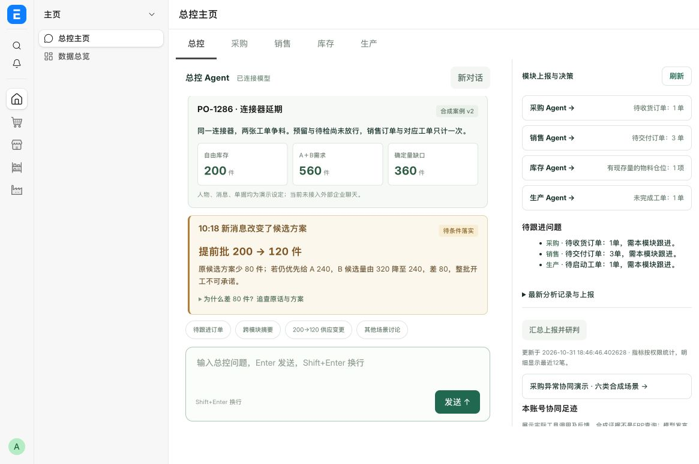

# 供应变更追溯与聊天排版验收

2026-10-31，本地 `focus.local`，未修改现有订单和库存。全部场景人物、聊天原文、业务编号和发生时间均为合成演示数据，真实模型参与部门核查，不代表接入真实企业聊天。

## 实测链路

总控「200→120 供应变更」→预览10条证据→开始四部门核查→加载10:18新消息→复核11条证据。浏览器已确认反馈逐步出现，结束后细节折叠；展开变化可查看两次原话、来源版本、关联方案和实际加载账号。

| 记录 | 执行耗时 | 模型请求 | 部门/总控反馈 | 留痕 |
| --- | ---: | ---: | ---: | ---: |
| v1，gjj6n65g2p | 57.054秒 | 11 | 10 | 42 |
| v2，hbnlr97kht | 35.526秒 | 10 | 10 | 40 |

以上为同一次本地验收的单次抽测，不能据此承诺稳定性能；v1模型额外复查一次证据。四部门每阶段并行，阶段之间保留依赖。

## 量与来源校验

- 自由库存：780−420预留−160待检＝200；两张工单需560，销售订单不重复加总；确定量缺口360。
- v1候选量：200＋申请调整160＋可能提前200＝560；v2候选量480，条件缺口80。预留、补回、运输、本厂放行都未落实，不能承诺开工或交付。
- 实际数据库校验：v2关联v1讨论；旧10条来源逐项完全相同，追加E11保留E05及版本。实际加载账号Administrator与合成供应商身份、场景时间分开。
- 直接初始化v2被拒绝；已有人员补充或来源基线变化时拒绝预设更新。人员补充会清除旧程序方案，避免继续使用失效计算。
- 确定性数量结论来自程序；模型反馈、费用与实际节省仍待验证。待办仅建议，未派发或执行。

## 自动检查与布局

合入主分支 e83aae5 后96项检查通过：应用Python67、领域与配置规则10、前端19。另通过主页切换、独立会话、输入法与发送交互检查。覆盖源文本转义、演示与真实账号分离、旧来源防覆盖、初始快照不泄露新消息、确认缺口和条件缺口区分。

最终合并版部署后，需求登记至采购审批的数据库回归9项通过（模拟模型响应，业务变更全部回滚），56项静态资源检查通过；浏览器刷新可恢复两轮真实模型记录和来源。静态资源验收时本机代理返回502，限定localhost直连后通过，未修改系统代理配置。

修复模板缩进被pre-wrap渲染造成的大块空白；扩大聊天区，部门短反馈、来源、步骤、待办按层级排列。进行中显示部门进度，结束后默认结论优先。模型证据去重，v1/v2输入字节减少约45%，完整来源与持久化事件保留。

本地使用已验证镜像更新应用，无新增依赖和结构迁移；保留站点、数据库及回退镜像`caigou-copilot:before-trace-case`。验收界面截图随本地交付提供。

